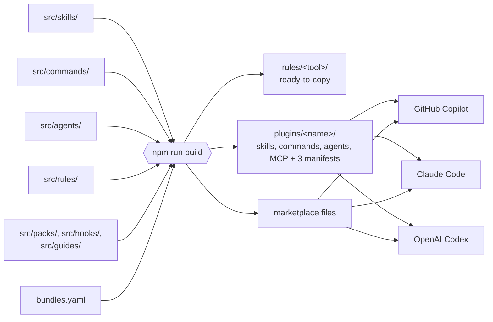
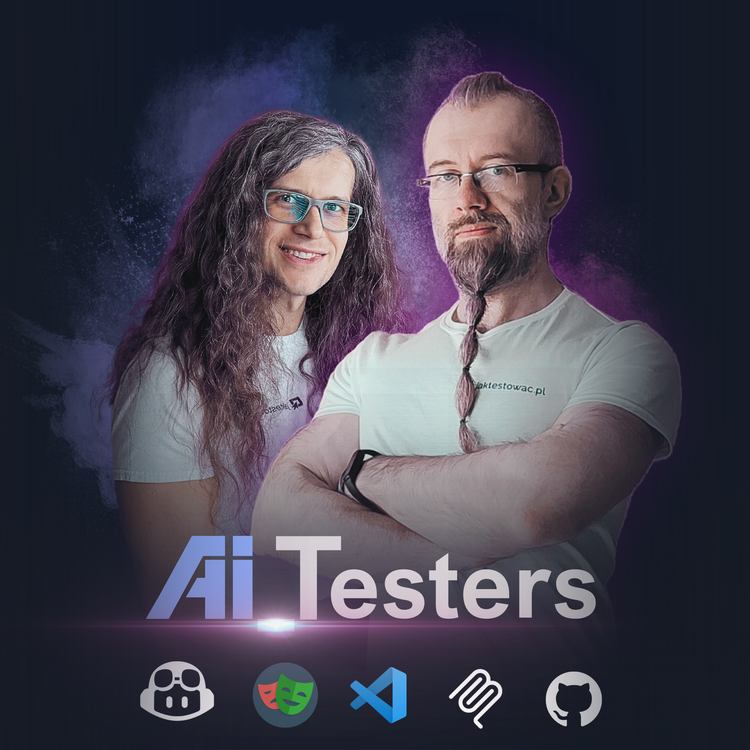

<div align="center">

<picture>
  <source media="(prefers-color-scheme: dark)" srcset="assets/banner-dark.svg">
  <source media="(prefers-color-scheme: light)" srcset="assets/banner-light.svg">
  
</picture>

<!-- START_BADGES -->

<p align="center">
  
  
  
  
  
</p>
<p align="center">
  
  
  
  
</p>

<!-- END_BADGES -->

**[Quick start](#-quick-start)** · **[Plugins](#-plugins)** · **[Guides](#-guides)** · **[Find a skill](#-i-want-to)** · **[Skills](#-skills)** · **[Commands](#%EF%B8%8F-commands)** · **[Agents](#-agents)** · **[Packs](#-orchestration-packs)** · **[Rules](#-rules)** · **[Hooks](#-hooks)** · **[Tool support](#-tool-support)** · **[How it works](#%EF%B8%8F-how-it-works)** · **[Contributing](#-contributing)** · **[Inspiration](#-inspiration)** · **[Follow us](#-follow-us)**

</div>

<br>

**Awesome Agents for Quality** is a toolkit of agent skills, commands, custom agents, orchestration packs, coding rules and hooks for testers, developers who write their own tests, tech leads who own quality gates, and teams shipping LLM features. You write a test plan, a bug report, a contract test or a release-readiness call the way you always have; the agent just does it with the discipline of an experienced quality engineer.

It is written once and packaged for **GitHub Copilot**, **Claude Code** and **OpenAI Codex**, so your team gets the same skills and agents whichever tool each person prefers.

> [!NOTE]
> 🚧 **Early release.** Everything from [awesome-copilot-for-testers](https://github.com/jaktestowac/awesome-copilot-for-testers) has moved over; its themed sets became the guides below. The plugins have not yet been installed end to end in every tool, so please [report](https://github.com/jaktestowac/awesome-agents-for-quality/issues) anything that does not work.

## ✨ Why this collection

<table>
<tr>
<td width="50%" valign="top">

### 🎯 Built for quality work

Not generic coding help. Every skill covers a real testing job: risk-based test design, exploratory charters, flaky-test triage, contract testing, accessibility audits, release gates, LLM guardrails.

</td>
<td width="50%" valign="top">

### 🔁 One source, three tools

Each skill is written once in the open [Agent Skills](https://agentskills.io) format and built into native plugins for Copilot, Claude Code and Codex. No forks, no drift.

</td>
</tr>
<tr>
<td width="50%" valign="top">

### 🧠 Loads only what it needs

A skill's short description is all the agent sees until the skill is relevant. Templates, checklists and examples sit in `resources/` and load on demand, so your context stays clean.

</td>
<td width="50%" valign="top">

### ✅ Checked on every change

CI validates every skill's frontmatter and bundle membership and fails if a generated plugin falls out of sync with its source.

</td>
</tr>
</table>

## 🚀 Quick start

Pick your tool, add the marketplace once, then install the plugins you want. Every plugin is listed in the [table below](#-plugins).

> [!WARNING]
> The plugin commands follow each tool's documentation but have not yet been run end to end against this repository. If one fails, please [open an issue](https://github.com/jaktestowac/awesome-agents-for-quality/issues).

<details open>
<summary><b></b></summary>

<br>

```text
/plugin marketplace add jaktestowac/awesome-agents-for-quality
/plugin install qa-core@jaktestowac
```

</details>

<details>
<summary><b></b></summary>

<br>

```text
copilot plugin marketplace add jaktestowac/awesome-agents-for-quality
copilot plugin install qa-core@jaktestowac
```

</details>

<details>
<summary><b></b></summary>

<br>

```text
codex plugin marketplace add jaktestowac/awesome-agents-for-quality
```

Then install the plugins you want from the Codex plugin list.

</details>

<details>
<summary><b>📁 Any tool, one skill at a time</b></summary>

<br>

Copy a skill folder from [`src/skills/`](src/skills/) into the folder your tool reads. Copy the whole folder, including `resources/`.

| Tool           | Project folder            | Personal folder              |
| -------------- | ------------------------- | ---------------------------- |
| Claude Code    | `.claude/skills/<skill>/` | `~/.claude/skills/<skill>/`  |
| GitHub Copilot | `.github/skills/<skill>/` | `~/.copilot/skills/<skill>/` |
| OpenAI Codex   | `.agents/skills/<skill>/` | `~/.agents/skills/<skill>/`  |

Pick one route per skill: a skill installed both as a plugin and by hand loads twice.

</details>

## 📦 Plugins

Skills are grouped into themed plugins, so one install gives you a complete workflow.

<!-- START_PLUGINS -->

| Plugin | What it covers | Skills | Commands | Agents | Install id |
| --- | --- | :---: | :---: | :---: | --- |
| 🧭 **[qa-core](plugins/qa-core/)** | Test design, planning, exploratory testing, requirements traceability and bug reporting. | 11 | 15 | 4 | `qa-core@jaktestowac` |
| 🤖 **[test-automation](plugins/test-automation/)** | Unit tests, TDD, Playwright, mocking, visual regression, migration and test code review. | 15 | 11 | 5 | `test-automation@jaktestowac` |
| 🔌 **[api-testing](plugins/api-testing/)** | API test automation with Playwright and contract testing. | 2 | 1 | 2 | `api-testing@jaktestowac` |
| ⚡ **[non-functional-testing](plugins/non-functional-testing/)** | Accessibility, performance and load, and application security testing. | 3 | 3 | 1 | `non-functional-testing@jaktestowac` |
| 🧠 **[ai-quality](plugins/ai-quality/)** | Testing LLM features, guardrails, groundedness and agent skills. | 5 | 2 | 1 | `ai-quality@jaktestowac` |
| 🚦 **[quality-gates](plugins/quality-gates/)** | Quality contracts, change gates, waivers, release readiness, metrics and debt. | 13 | 4 | 4 | `quality-gates@jaktestowac` |
| 🛠️ **[authoring](plugins/authoring/)** | Creating skills, custom agents, commands and prompt files, instructions and rules, hooks, plugins and orchestration packs for GitHub Copilot, Claude Code and OpenAI Codex, plus auditing a whole collection. Each covers this repository's single-source format and your own project's native files. | 7 | 2 | 1 | `authoring@jaktestowac` |

<!-- END_PLUGINS -->

## 📘 Guides

Guides walk through a whole workflow: which skills, commands, agents and rules to use together, in what order, and what they won't do for you. Each one ships inside its plugin.

<!-- START_GUIDES -->

| Guide | What it covers | Plugin |
| --- | --- | --- |
| 📘 **[Beyond Codegen 2.0](plugins/qa-core/guides/beyond-codegen.md)** | A guide to two-stage AI test generation: the model first designs risk-based test scenarios, a human reviews them, and only the approved scenarios are turned into test code. | `qa-core` |
| 📘 **[AI product QA](plugins/ai-quality/guides/ai-product-qa.md)** | A guide to testing products that **ship an LLM** - prompts, agents, RAG, tool-calling - as opposed to using AI to write tests. | `ai-quality` |
| 📘 **[Quality governance](plugins/quality-gates/guides/quality-governance.md)** | A guide to the layer above test writing: deciding **which** quality practices this project actually commits to, detecting whether they are enforced, recording the exceptions honestly, and making the direction visible over time. | `quality-gates` |

<!-- END_GUIDES -->

## 🔎 I want to…

| I want to…                                      | Use this skill                                                                               | Plugin                   |
| ----------------------------------------------- | -------------------------------------------------------------------------------------------- | ------------------------ |
| Turn a user story into risk-based test cases    | [`designing-functional-tests`](src/skills/designing-functional-tests/SKILL.md)               | `qa-core`                |
| Plan a time-boxed exploratory session           | [`planning-exploratory-testing`](src/skills/planning-exploratory-testing/SKILL.md)           | `qa-core`                |
| Write a bug report a developer can act on       | [`reporting-bugs`](src/skills/reporting-bugs/SKILL.md)                                       | `qa-core`                |
| Check acceptance criteria against the build     | [`verifying-acceptance-criteria`](src/skills/verifying-acceptance-criteria/SKILL.md)         | `qa-core`                |
| Add unit tests to code that has none            | [`writing-unit-tests`](src/skills/writing-unit-tests/SKILL.md)                               | `test-automation`        |
| Catch tests that pass without proving anything  | [`unslop-tests`](src/skills/unslop-tests/SKILL.md)                                           | `test-automation`        |
| Find out why a test fails                       | [`diagnosing-test-failures`](src/skills/diagnosing-test-failures/SKILL.md)                   | `test-automation`        |
| Fix a test that passes on retry                 | [`stabilizing-flaky-tests`](src/skills/stabilizing-flaky-tests/SKILL.md)                     | `test-automation`        |
| Decide how a new test suite should be organised | [`designing-test-automation-architecture`](src/skills/designing-test-automation-architecture/SKILL.md) | `test-automation` |
| Run tests in CI fast, sharded and with reports  | [`automating-ci-test-pipelines`](src/skills/automating-ci-test-pipelines/SKILL.md)           | `test-automation`        |
| Move a Cypress or Selenium suite to Playwright  | [`migrating-tests-to-playwright`](src/skills/migrating-tests-to-playwright/SKILL.md)         | `test-automation`        |
| Stop an API change from breaking consumers      | [`testing-api-contracts`](src/skills/testing-api-contracts/SKILL.md)                         | `api-testing`            |
| Audit a page against WCAG 2.2                   | [`auditing-accessibility`](src/skills/auditing-accessibility/SKILL.md)                       | `non-functional-testing` |
| Plan a load test with real pass/fail thresholds | [`testing-performance-and-load`](src/skills/testing-performance-and-load/SKILL.md)           | `non-functional-testing` |
| Build an eval suite for an LLM feature          | [`testing-llm-features`](src/skills/testing-llm-features/SKILL.md)                           | `ai-quality`             |
| Red-team a chatbot's guardrails                 | [`testing-llm-guardrails`](src/skills/testing-llm-guardrails/SKILL.md)                       | `ai-quality`             |
| Decide which tests a diff needs to rerun        | [`analyzing-regression-scope`](src/skills/analyzing-regression-scope/SKILL.md)               | `quality-gates`          |
| Make a go/no-go call on a release               | [`assessing-release-readiness`](src/skills/assessing-release-readiness/SKILL.md)             | `quality-gates`          |
| Set up CI quality gates for a repo              | [`generating-quality-gate-workflows`](src/skills/generating-quality-gate-workflows/SKILL.md) | `quality-gates`          |
| Check that my own skill triggers when it should | [`testing-agent-skills`](src/skills/testing-agent-skills/SKILL.md)                           | `ai-quality`             |

## 📚 Skills

Skills are expertise your agent loads on its own when your request matches: test design, flaky-test triage, contract testing, release gates and more. You never have to call them.

<!-- START_SKILLS -->

**56 skills** across 7 plugins: [qa-core](catalog/skills.md#qa-core) (11) · [test-automation](catalog/skills.md#test-automation) (15) · [api-testing](catalog/skills.md#api-testing) (2) · [non-functional-testing](catalog/skills.md#non-functional-testing) (3) · [ai-quality](catalog/skills.md#ai-quality) (5) · [quality-gates](catalog/skills.md#quality-gates) (13) · [authoring](catalog/skills.md#authoring) (7).

👉 **[Browse the skill catalog](catalog/skills.md)** for what each one does and the templates it ships with.

<!-- END_SKILLS -->

## ⌨️ Commands

Commands are ready-made prompts you run yourself when you want a specific job done, such as `/fix-tests` or `/bug-report`. Type the command, then what it should work on. If something it needs is missing, it asks. In Claude Code and Copilot run `/fix-tests tests/checkout`; in Codex, `$fix-tests tests/checkout`. Commands never start on their own.

<!-- START_COMMANDS -->

👉 **[Browse all 38 commands](catalog/commands.md)**, with what each one does and the agent it hands off to.

<!-- END_COMMANDS -->

## 🤖 Agents

Agents are specialists with their own instructions and a fixed set of tools. Hand one a whole job, such as "review these tests" or "plan the testing for this story", and it works through it end to end. Each agent ships in the plugin listed next to it.

<!-- START_AGENTS -->

👉 **[Browse all 18 agents](catalog/agents.md)**, with what each may do (edit files, run commands, drive a browser) and how to call it in each tool.

<!-- END_AGENTS -->

## 🎼 Orchestration packs

A pack is a team of agents with one orchestrator that splits a big job across them, such as "explore this app, plan the tests, write them, review them, run them". Each subagent works in its own context and returns a short handoff, so the main conversation stays small.

<!-- START_PACKS -->

| Pack | What it does | Agents | Start it | Install id |
| --- | --- | :---: | --- | --- |
| 🎼 **[Orchestration basics](plugins/orchestration-basics/)** | A minimal orchestrator with three read-mostly helpers (planner, explorer, analyst) that shows how to split analysis and planning across subagents to save context, with stop gates for the user. | 4 | Copilot: **Orchestrator** agent<br>Claude Code: `/orchestration-basics`<br>Codex: `$orchestration-basics` | `orchestration-basics@jaktestowac` |
| 🎼 **[Plan, explore, review, commit](plugins/plan-explore-review-commit/)** | A full delivery pipeline: a planner and an orchestrator drive architect, researcher, explorer, implementer, QA strategy, security, code review and docs subagents through small test-first phases, with a review and a user-approved commit after each. | 10 | Copilot: **Orchestrator Agent** agent<br>Claude Code: `/plan-explore-review-commit`<br>Codex: `$plan-explore-review-commit` | `plan-explore-review-commit@jaktestowac` |
| 🎼 **[UI + API test automation](plugins/ui-api-automation/)** | Explores an application (frontend through Playwright MCP, backend through its OpenAPI spec), plans coverage, implements UI and API tests, reviews them and runs them to a verified result. | 8 | Copilot: **QA Orchestrator** agent<br>Claude Code: `/ui-api-automation`<br>Codex: `$ui-api-automation` | `ui-api-automation@jaktestowac` |
| 🎼 **[UI + API test automation (minimal)](plugins/ui-api-automation-minimal/)** | A compact UI + API pack with four helpers: explore (OpenAPI and/or Playwright MCP), plan, set up a test framework if none exists, and implement tests, each returning the same handoff packet. | 5 | Copilot: **QA Orchestrator (Minimal)** agent<br>Claude Code: `/ui-api-automation-minimal`<br>Codex: `$ui-api-automation-minimal` | `ui-api-automation-minimal@jaktestowac` |

<!-- END_PACKS -->

In Copilot the orchestrator is an agent that hands off to the others. Claude Code and Codex agents can't start other agents, so there the orchestrator is a command that runs in your conversation and calls the pack's agents one by one. Each pack's README lists its agents, and its GUIDE walks through the workflow.

## 📏 Rules

Rules are coding standards your agent applies on its own whenever it edits matching files: Playwright locator discipline, API test structure, CI gate hygiene and more. None of the tools installs rules through a plugin, so each tool gets a ready-to-copy folder in [`rules/`](rules/) that mirrors your project layout.

<!-- START_RULES -->

👉 **[Browse all 8 rules](rules/README.md)**, with the files each applies to, in Copilot, Claude Code and Codex format.

<!-- END_RULES -->

## 🪝 Hooks

Hooks run a script when something happens in a session: it starts, a tool is about to run, a file was just edited. They turn "the agent should remember to…" into something that actually happens every time.

<!-- START_HOOKS -->

| Hook | What it does | Claude Code | Copilot |
| --- | --- | --- | :---: |
| **Always-on skills** | Keeps always-apply skill invariants, such as unslop-tests, in force for the whole session, and restates the relevant one after each edit to a file in its scope. | `/plugin install always-on-skills@jaktestowac` | [📁](hooks/copilot/.github/hooks/always-on-skills/) |
| **Print tool info** | Shows the tool name, arguments, time and working directory before each tool call. | `/plugin install print-tool-info@jaktestowac` | [📁](hooks/copilot/.github/hooks/print-tool-info/) |

<!-- END_HOOKS -->

Each hook is a separate install, so getting a skills plugin never adds hooks you didn't ask for. In Claude Code the hooks run on Node.js; for Copilot, copy the folder (📁) into your project. See [hooks/README.md](hooks/README.md) for details.

## 🧩 Tool support

| |  |  |  |
| --- | :---: | :---: | :---: |
| Agent skills | ✅ | ✅ | ✅ |
| Plugins and marketplace | ✅ | ✅ | ✅ |
| Commands | ✅ | ✅ | ✅ |
| Custom agents | ✅ | ✅ | ✅ ¹ |
| MCP server config | ✋ ² | ✅ | ✅ |
| Rules / instructions | ✋ ³ | ✋ ³ | ✋ ³ |
| Hooks | ✋ ³ | ✅ | — |
| Orchestration packs | ✅ | ✅ | ✅ ¹ |

✅ available · ✋ manual step · 🚧 planned · — not planned for now

¹ Codex doesn't load agents from plugins yet. Copy them from the plugin's `codex/agents/` folder into `.codex/agents/`.<br>
² Add the [Playwright MCP server](https://github.com/microsoft/playwright-mcp) to your Copilot MCP configuration yourself.<br>
³ Copy the folder for your tool from [`rules/`](rules/) or [`hooks/`](hooks/) into your project.

## ⚙️ How it works



Each skill lives once in [`src/skills/`](src/skills/), each command in [`src/commands/`](src/commands/) and each agent in [`src/agents/`](src/agents/). Commands are built into skills that only you can start. An agent declares what it may do (read, edit, run commands…) rather than any one tool's tool names. [`bundles.yaml`](bundles.yaml) decides which plugin each one ships in. `npm run build` writes one folder per plugin into [`plugins/`](plugins/): a manifest for each tool, real copies of the skills, every agent in Claude Code, Copilot and Codex format, and the MCP config the agents need, plus the marketplace file each tool reads. The tables in this README are generated by the same step, so they always match the skills.

## 📖 Learn the building blocks

|                                                                                                                                    | Docs                                                                                                                                                                                                                                                                                                                                              |
| ---------------------------------------------------------------------------------------------------------------------------------- | ------------------------------------------------------------------------------------------------------------------------------------------------------------------------------------------------------------------------------------------------------------------------------------------------------------------------------------------------- |
| 🧱 **Agent Skills standard**                                                                                                       | [agentskills.io](https://agentskills.io)                                                                                                                                                                                                                                                                                                          |
|  | [Agent skills](https://code.visualstudio.com/docs/copilot/customization/agent-skills) · [Agent plugins](https://code.visualstudio.com/docs/agent-customization/agent-plugins) · [Custom agents](https://code.visualstudio.com/docs/copilot/customization/custom-agents) · [Hooks](https://code.visualstudio.com/docs/copilot/customization/hooks) |
|        | [Skills](https://code.claude.com/docs/en/skills) · [Plugins](https://code.claude.com/docs/en/plugins) · [Subagents](https://code.claude.com/docs/en/sub-agents) · [Hooks](https://code.claude.com/docs/en/hooks)                                                                                                                                  |
|                                         | [Skills](https://learn.chatgpt.com/docs/build-skills) · [Plugins](https://developers.openai.com/codex/plugins/build) · [Subagents](https://learn.chatgpt.com/docs/agent-configuration/subagents)                                                                                                                                                  |

## 🌱 Contributing

New skills, fixes and better triggers are all welcome. Skills are edited in `src/skills/`, and `npm run build` regenerates everything else. The [Contributing Guide](CONTRIBUTING.md) has the steps and house rules.

## 🙏 Inspiration

These collections and resources shaped how this one is written and organised. Thank you to their authors.

| Resource | What we learned from it |
| --- | --- |
| [Agent Skills specification](https://agentskills.io) | The open `SKILL.md` format every skill here is written in |
| [anthropics/skills](https://github.com/anthropics/skills) | Skill authoring: descriptions that trigger, progressive disclosure, matching how strict an instruction is to how fragile the step is |
| [openai/skills](https://github.com/openai/skills) | Skill and plugin packaging for Codex, and how it differs from the other tools |
| [github/awesome-copilot](https://github.com/github/awesome-copilot) | Custom agents, prompts, instructions and hooks for Copilot, and the starting point for the PRD skill |
| [addyosmani/agent-skills](https://github.com/addyosmani/agent-skills) | Skill anatomy with common rationalizations, red flags and evidence-based verification; measuring skill routing |
| [mattpocock/skills](https://github.com/mattpocock/skills) | Writing for agents: completion criteria, leading words, positive phrasing, pruning; a feedback-loop-first approach to debugging |
| [vercel-labs/agent-skills](https://github.com/vercel-labs/agent-skills) | Compact, focused skills built around reference material |
| [currents-dev/playwright-best-practices-skill](https://github.com/currents-dev/playwright-best-practices-skill) | Current Playwright practice: locators, web-first assertions, fixtures, auth, network mocking, CI |
| [hesreallyhim/awesome-claude-code](https://github.com/hesreallyhim/awesome-claude-code) | A wide survey of Claude Code commands, hooks and workflows |
| [jaktestowac/awesome-copilot-for-testers](https://github.com/jaktestowac/awesome-copilot-for-testers) | Custom agents, prompts and workflows for Copilot aimed at testers |

## 🎓 Learning resources

<div align="center">
  <a href="https://aitesters.pl" ></a>
</div>

### 🤖 AI_Testers

Combine AI with the tools testers already use, and build a professional test automation framework faster.

- [AI_Testers](https://aitesters.pl): the programme
- [Free Playwright and AI courses](https://jaktestowac.pl/darmowy-playwright)
- [Follow AI_Testers](#-follow-us) on YouTube, LinkedIn, Instagram and GitHub


**🇵🇱 In Polish**

- 💡 **Free** [Playwright resources](https://jaktestowac.pl/darmowy-playwright/)
- [JavaScript and TypeScript for Testers](https://jaktestowac.pl/js-ts/): 13h+ course
- [Professional Test Automation with Playwright](https://jaktestowac.pl/playwright/): 100h+ course covering CI/CD and test architecture
- [Back-end Test Automation](https://jaktestowac.pl/api/): 45h+ course
- YouTube: [Playwright Basics](https://www.youtube.com/playlist?list=PLfKhn9AcZ-cD2TCB__K7NP5XARaCzZYn7) · [Playwright Elements](https://www.youtube.com/playlist?list=PLfKhn9AcZ-cAcpd-XN4pKeo-l4YK35FDA) · [Playwright MCP](https://www.youtube.com/playlist?list=PLfKhn9AcZ-cCqD34AG5YRejujaBqCBgl4)
- [Playwright Info](https://playwright.info/): the Polish Playwright blog
- [Discord](https://discord.com/invite/mUAqQ7FUaZ): the first Polish Playwright community

**🇬🇧 In English**

- [Our VS Code extensions](https://marketplace.visualstudio.com/publishers/jaktestowac-pl): free Playwright tooling
- [Playwright documentation](https://playwright.dev/docs/intro)

## 📣 Follow us

### jaktestowac.pl

Courses, free Playwright materials and the Polish testing community.

- <a href="https://jaktestowac.pl"></a>
- <a href="https://www.youtube.com/@jaktestowac"></a>
- <a href="https://www.linkedin.com/company/jaktestowac/"></a>
- <a href="https://www.instagram.com/jaktestowac.pl/"></a>
- <a href="https://github.com/jaktestowac"></a>
- <a href="https://discord.com/invite/mUAqQ7FUaZ"></a>

### AI_Testers

The courses and resources for testers and engineers who want to work with AI.

- <a href="https://aitesters.pl"></a>
- <a href="https://www.youtube.com/@AITesterspl"></a>
- <a href="https://www.linkedin.com/company/aitesters/"></a>
- <a href="https://www.instagram.com/aitesterspl/"></a>
- <a href="https://github.com/AI-Testers-pl"></a>
- <a href="https://discord.com/invite/mUAqQ7FUaZ"></a>


Questions or ideas? Use the [contact form](https://jaktestowac.pl/kontakt) or [open an issue](https://github.com/jaktestowac/awesome-agents-for-quality/issues).

<br>

<div align="center">

**Happy testing!** 🚀

Made with ❤️💚 by the **[jaktestowac.pl](https://jaktestowac.pl)** x **[AI_Testers](https://aitesters.pl)** team

</div>
